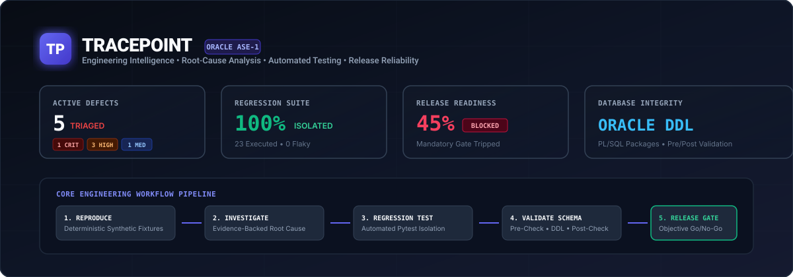
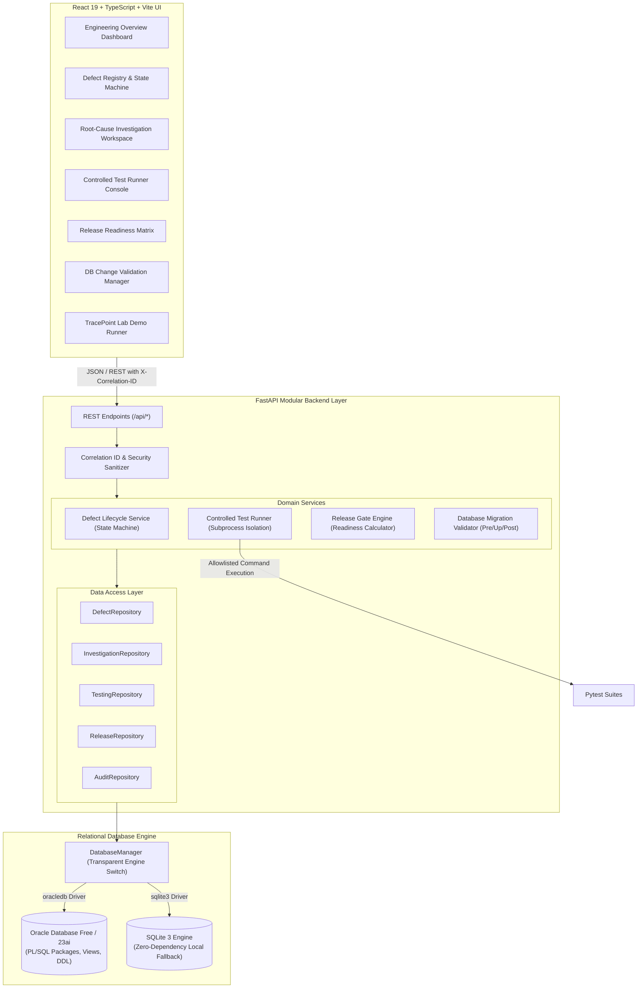
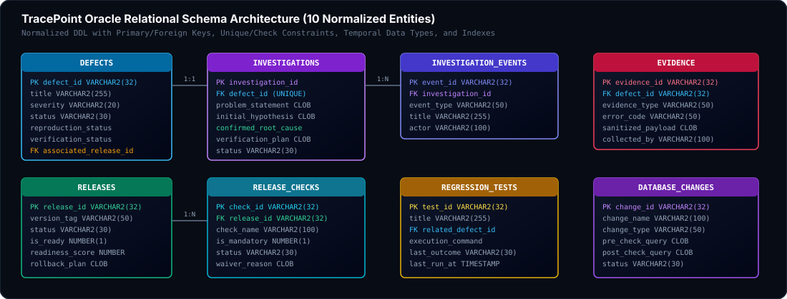
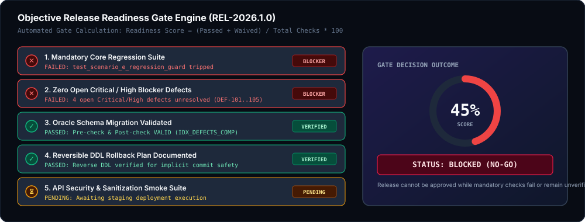

<div align="center">



# TRACEPOINT
### Engineering Intelligence, Root-Cause Analysis, Automated Testing & Release Reliability Platform

[](https://www.python.org/)
[](https://fastapi.tiangolo.com/)
[](https://www.oracle.com/database/)
[](https://react.dev/)
[](https://www.typescriptlang.org/)
[](https://vite.dev/)
[](https://tailwindcss.com/)
[](file:///tests/)
[](#)

</div>

---

## 1. Executive Summary & Business Problem

In enterprise software engineering, defect management often deteriorates because defects are treated as disconnected tickets. Teams repeatedly suffer from:
1. **Unreproducible Failures**: Bug reports lack deterministic inputs, preconditions, and fixture references.
2. **Confusing Hypothesis with Fact**: Speculative explanations are accepted without supporting technical evidence.
3. **Recurring Regressions**: Defect fixes are merged without automated regression tests to protect against recurrence.
4. **Unsafe Schema Migrations**: DDL operations are executed directly against databases without pre-checks or rollback safety.
5. **Subjective Release Approvals**: Releases are approved on gut feeling rather than objective test runs and blocker checks.

**TracePoint** organizes and enforces this entire workflow into an evidence-backed system of record:
$$\text{Defect} \longrightarrow \text{Reproduction} \longrightarrow \text{Evidence} \longrightarrow \text{Investigation} \longrightarrow \text{Fix} \longrightarrow \text{Regression Test} \longrightarrow \text{Release Gate}$$

---

## 2. System Architecture & Component Interaction



---

## 3. Defect Lifecycle State Machine

Transitions between defect states are strictly guarded. A defect cannot become `VERIFIED` or `CLOSED` simply because a user clicks a button; it requires verified test execution and attached technical evidence.


### Valid State Transitions Matrix

| From State | Permitted Target States | Enforced Gate Conditions |
| :--- | :--- | :--- |
| `OPEN` | `REPRODUCED`, `INVESTIGATING`, `REJECTED`, `DUPLICATE`, `INCONCLUSIVE` | Initial triage. |
| `REPRODUCED` | `INVESTIGATING`, `FIX_PROPOSED`, `INCONCLUSIVE` | Requires recorded reproduction steps. |
| `INVESTIGATING` | `FIX_PROPOSED`, `INCONCLUSIVE`, `REJECTED`, `REPRODUCED` | Investigation hypothesis recorded. |
| `FIX_PROPOSED` | `VALIDATION_REQUIRED`, `INVESTIGATING` | Requires proposed code or SQL correction. |
| `VALIDATION_REQUIRED` | `VERIFIED`, `FIX_PROPOSED`, `INVESTIGATING` | **Integrity Guard:** Requires `verification_status = 'VERIFIED'` and attached evidence. |
| `VERIFIED` | `CLOSED`, `OPEN` | Target release evaluation. Transitioning to `OPEN` triggers regression audit. |
| `CLOSED` | `OPEN` | Reopens defect and logs regression event. |

---

## 4. Oracle Relational Database Architecture

TracePoint features a normalized 10-table relational schema designed for Oracle Database Free / 23ai / 19c.



### Database Schema Data Dictionary

| Table Name | Primary Key | Foreign Keys | Key Constraints & Indexes | Purpose |
| :--- | :--- | :--- | :--- | :--- |
| `DEFECTS` | `defect_id` | `associated_release_id` $\rightarrow$ `RELEASES` | `CHECK` severity, status, verification; B-Tree indexes on status, severity. | Core defect registry and metadata. |
| `REPRODUCTIONS` | `reproduction_id` | `defect_id` $\rightarrow$ `DEFECTS` (`CASCADE`) | `CHECK` outcome, frequency; ordered steps JSON. | Deterministic reproduction execution records. |
| `INVESTIGATIONS` | `investigation_id` | `defect_id` $\rightarrow$ `DEFECTS` (`UNIQUE`) | Separates Observation, Hypothesis, Confirmed Cause. | Core root-cause analysis workspace. |
| `INVESTIGATION_EVENTS` | `event_id` | `investigation_id` $\rightarrow$ `INVESTIGATIONS` | Chronological event order index; actor audit. | Persistent event timeline for each investigation. |
| `EVIDENCE` | `evidence_id` | `defect_id` $\rightarrow$ `DEFECTS` (`CASCADE`) | `CHECK` evidence type; error code indexing. | Sanitized SQL queries, logs, execution plans. |
| `REGRESSION_TESTS` | `test_id` | `related_defect_id` $\rightarrow$ `DEFECTS` | `CHECK` category, outcome; allowlisted command. | Automated test catalog preventing recurrence. |
| `TEST_RUNS` | `run_id` | `related_defect_id`, `related_release_id` | Bounded execution telemetry; passed/failed counts. | Controlled test execution history. |
| `RELEASES` | `release_id` | — | `UNIQUE` version tag; readiness score calculation. | Release versions, tags, and rollback plans. |
| `RELEASE_CHECKS` | `check_id` | `release_id` $\rightarrow$ `RELEASES` (`CASCADE`) | `CHECK` mandatory flag, check status, waiver reason. | Objective release readiness checklist. |
| `DATABASE_CHANGES` | `change_id` | — | Pre-check query, Up DDL, Post-check, Rollback script. | Controlled 4-phase schema migration manager. |
| `AUDIT_LOG` | `audit_id` | — | Immutable append-only ledger; correlation ID index. | Transactional audit trail for all operations. |

### Real PL/SQL Packages

1. **`PKG_DEFECT_LIFECYCLE`** ([`database/packages/03_pkg_defect_lifecycle.sql`](file:///database/packages/03_pkg_defect_lifecycle.sql)):
   - Procedure `transition_defect(p_defect_id, p_new_status, p_actor, p_reason, p_status_code, p_message)`:
     Validates the state transition, ensures verification criteria are satisfied, updates the defect, and writes to `AUDIT_LOG` within an atomic transaction.
2. **`PKG_RELEASE_GATE`** ([`database/packages/04_pkg_release_gate.sql`](file:///database/packages/04_pkg_release_gate.sql)):
   - Procedure `evaluate_readiness(p_release_id, p_is_ready, p_score, p_blockers)`:
     Scans mandatory release checks, scans for open `CRITICAL`/`HIGH` defects, checks regression runs, and calculates score ($0–100\%$).

---

## 5. Controlled Demonstration Scenarios: TracePoint Lab

TracePoint includes an isolated demonstration service (**TracePoint Lab**) with 5 reproducible failure scenarios.

### Demonstration Scenarios Matrix

| Scenario | Component | Buggy Behavior | Root Cause | Corrected & Verified Behavior | Automated Test Suite |
| :--- | :--- | :--- | :--- | :--- | :--- |
| **A: Date Boundary** | `billing-service` | Omitted $48,200 on monthly reconciliations. Returned $26,800 instead of $75,000. | String comparison coerced `end_date` to midnight `00:00:00`, dropping records at `23:55:00`. | Uses half-open interval `[start, end + 1 day)` or `<= 23:59:59`. Returns true $75,000 total. | [`test_scenario_a_date_boundary.py`](file:///demo_lab/tests/test_scenario_a_date_boundary.py) |
| **B: Duplicate Joins** | `order-analytics` | Order reporting query reported 3x inflated sales ($60,000 instead of $20,000). | Joining `ORDERS` to `SHIPMENTS` without grouping caused cartesian fan-out (2 items $\times$ 3 shipments = 6 rows). | Uses CTE aggregating shipments distinctly before line summation. Returns exact $20,000. | [`test_scenario_b_duplicate_aggregation.py`](file:///demo_lab/tests/test_scenario_b_duplicate_aggregation.py) |
| **C: State Bypass** | `invoice-workflow` | Enterprise invoices > $50,000 transitioned directly from `DRAFT` to `ISSUED`. | Direct status setter lacked backend state machine guard validation. | Backend validation rejects unapproved high-value invoice issuance with HTTP 422. | [`test_scenario_c_invalid_transition.py`](file:///demo_lab/tests/test_scenario_c_invalid_transition.py) |
| **D: DB Rollback** | `settlement-processor`| Batch payment settlement committed partial rows on foreign key violation. | Runner autocommitted per row; lacked explicit transaction block with rollback. | Wraps batch in atomic transaction with `ROLLBACK` on constraint violation. 0 orphaned rows. | [`test_scenario_d_db_integrity.py`](file:///demo_lab/tests/test_scenario_d_db_integrity.py) |
| **E: Regression** | `checkout-engine` | Speed optimization to discount calculation accepted expired coupon codes. | Expiration check was moved inside fixed-dollar branch only; percentage coupons bypassed check. | Restores expiration check to base validation path prior to calculation. Rejects expired codes. | [`test_scenario_e_regression_guard.py`](file:///demo_lab/tests/test_scenario_e_regression_guard.py) |

---

## 6. Objective Release Readiness Engine

A software release cannot proceed based on human opinions. The Release Readiness Engine computes readiness deterministically using persisted checks:



$$\text{Readiness Score} = \left( \frac{\text{Passed Checks} + \text{Waived Checks}}{\text{Total Checks}} \right) \times 100$$

### Release Checks Specification

| Check Name | Category | Mandatory | Pass Criteria | Impact if Tripped |
| :--- | :--- | :---: | :--- | :--- |
| **Mandatory Core Regression Suite** | `REGRESSION_VERIFICATION` | **YES** | All test suites guarding release components must pass. | **BLOCKS RELEASE** |
| **Zero Open Critical/High Blocker Defects** | `BLOCKER_TRIAGE` | **YES** | Zero unresolved `CRITICAL` or `HIGH` defects linked to release. | **BLOCKS RELEASE** |
| **Oracle Schema Migration Validated** | `DATABASE_MIGRATION` | **YES** | Pre-check, up DDL, and post-check verified on target schema. | **BLOCKS RELEASE** |
| **Rollback Strategy Documented** | `ROLLBACK_PLAN` | **YES** | Reversible migration DDL and container rollback tags verified. | **BLOCKS RELEASE** |
| **API Security & Sanitization Smoke** | `SECURITY_SMOKE` | **YES** | Smoke pass confirms no sensitive stack traces are disclosed. | **BLOCKS RELEASE** |

---

## 7. Controlled Test Runner & Security Allowlist

To eliminate command-injection risks and unrestricted shell execution, TracePoint's runner executes only allowlisted commands through a bounded backend process (`TestRunnerService`):

| Allowlisted Test Command | Suite Identifier | Scope | Timeout |
| :--- | :--- | :--- | :---: |
| `pytest demo_lab/tests/test_scenario_a_date_boundary.py -v` | `TEST-SCENARIO-A` | Scenario A Date Boundary Verification | 25s |
| `pytest demo_lab/tests/test_scenario_b_duplicate_aggregation.py -v` | `TEST-SCENARIO-B` | Scenario B Join Cartesian Fan-Out Guard | 25s |
| `pytest demo_lab/tests/test_scenario_c_invalid_transition.py -v` | `TEST-SCENARIO-C` | Scenario C Workflow State Guard | 25s |
| `pytest demo_lab/tests/test_scenario_d_db_integrity.py -v` | `TEST-SCENARIO-D` | Scenario D Foreign Key Rollback Integrity | 25s |
| `pytest demo_lab/tests/test_scenario_e_regression_guard.py -v` | `TEST-SCENARIO-E` | Scenario E Discount Expiration Guard | 25s |
| `pytest tests/unit/ -v` | `SUITE-UNIT-CORE` | State Machine & Release Gate Unit Tests | 25s |
| `pytest tests/api/ -v` | `SUITE-API-CORE` | API Endpoint Contracts & Exception Sanitization | 25s |
| `pytest demo_lab/tests/ -v` | `SUITE-ALL-SCENARIOS` | All Demonstration Lab Regression Scenarios | 25s |

---

## 8. Automated Test Execution & Results

```
============================= test session starts =============================
platform win32 -- Python 3.14.7, pytest-8.4.2, pluggy-1.6.0
rootdir: C:\Users\saiya\Desktop\3, configfile: pytest.ini
collected 28 items

tests/api/test_api_endpoints.py::test_health_endpoint PASSED             [  3%]
tests/api/test_api_endpoints.py::test_dashboard_metrics PASSED           [  7%]
tests/api/test_api_endpoints.py::test_list_defects_with_pagination PASSED [ 10%]
tests/api/test_api_endpoints.py::test_create_and_transition_defect PASSED [ 14%]
tests/api/test_api_endpoints.py::test_test_runner_allowlist_security PASSED [ 17%]
tests/api/test_api_endpoints.py::test_test_runner_executes_allowlisted_suite PASSED [ 21%]
tests/api/test_api_endpoints.py::test_database_change_execution PASSED   [ 25%]
tests/integration/test_oracle_integration.py::TestOracleDatabaseIntegration::test_oracle_connection_banner SKIPPED [ 28%]
tests/integration/test_oracle_integration.py::TestOracleDatabaseIntegration::test_oracle_plsql_package_lifecycle SKIPPED [ 32%]
tests/integration/test_oracle_integration.py::TestOracleDatabaseIntegration::test_oracle_plsql_release_gate SKIPPED [ 35%]
tests/integration/test_oracle_integration.py::TestOracleDatabaseIntegration::test_oracle_foreign_key_constraint_enforcement SKIPPED [ 39%]
tests/integration/test_oracle_integration.py::TestOracleDatabaseIntegration::test_oracle_reporting_views SKIPPED [ 42%]
tests/unit/test_defect_lifecycle.py::test_valid_defect_transitions PASSED [ 46%]
tests/unit/test_defect_lifecycle.py::test_invalid_transition_rejected PASSED [ 50%]
tests/unit/test_defect_lifecycle.py::test_cannot_mark_verified_without_verification PASSED [ 53%]
tests/unit/test_release_gates.py::test_release_blocked_by_failed_checks_and_open_blockers PASSED [ 57%]
tests/unit/test_release_gates.py::test_ready_release_passes PASSED       [ 60%]
demo_lab/tests/test_scenario_a_date_boundary.py::test_scenario_a_reproduces_defect_in_buggy_mode PASSED [ 64%]
demo_lab/tests/test_scenario_a_date_boundary.py::test_scenario_a_verifies_fix PASSED [ 67%]
demo_lab/tests/test_scenario_b_duplicate_aggregation.py::test_scenario_b_reproduces_cartesian_fan_out_defect PASSED [ 71%]
demo_lab/tests/test_scenario_b_duplicate_aggregation.py::test_scenario_b_verifies_cte_grouping_fix PASSED [ 75%]
demo_lab/tests/test_scenario_c_invalid_transition.py::test_scenario_c_reproduces_invalid_transition_defect PASSED [ 78%]
demo_lab/tests/test_scenario_c_invalid_transition.py::test_scenario_c_verifies_transition_guard PASSED [ 82%]
demo_lab/tests/test_scenario_c_invalid_transition.py::test_scenario_c_permits_valid_transition_with_approval PASSED [ 85%]
demo_lab/tests/test_scenario_d_db_integrity.py::test_scenario_d_reproduces_orphaned_records_on_constraint_violation PASSED [ 89%]
demo_lab/tests/test_scenario_d_db_integrity.py::test_scenario_d_verifies_atomic_rollback PASSED [ 92%]
demo_lab/tests/test_scenario_e_regression_guard.py::test_scenario_e_reproduces_expired_coupon_regression PASSED [ 96%]
demo_lab/tests/test_scenario_e_regression_guard.py::test_scenario_e_regression_guard_verifies_rejection PASSED [100%]

======================== 23 passed, 5 skipped in 6.03s ========================
```

---

## 9. API Endpoints Reference

| HTTP Method | Route | Description | Request Payload | Response Model |
| :--- | :--- | :--- | :--- | :--- |
| `GET` | `/api/health` | System health, database dialect telemetry, driver status. | None | `SystemHealth` |
| `GET` | `/api/reports/dashboard` | Dashboard metrics: severity counts, blockers, resolution time. | None | `DashboardMetrics` |
| `GET` | `/api/reports/view/{name}` | Dynamic view executor for the 8 Oracle reporting views. | Path Param | `ReportQueryResponse` |
| `GET` | `/api/defects` | List defects with pagination and filtering. | Query Params | `DefectListResponse` |
| `POST` | `/api/defects` | Log new defect for engineering investigation. | `DefectCreate` | `DefectResponse` (201) |
| `POST` | `/api/defects/{id}/transition`| Execute state machine transition with validation. | `DefectTransitionRequest` | `DefectResponse` |
| `GET` | `/api/investigations/defect/{id}` | Get structured investigation (Observation, Hypothesis, Cause).| Path Param | `InvestigationResponse` |
| `POST` | `/api/investigations/{id}/events` | Append immutable timeline event to investigation. | `InvestigationEventCreate` | `InvestigationEventResponse` (201) |
| `GET` | `/api/testing/tests` | List automated regression test catalog. | None | `List[RegressionTestResponse]` |
| `POST` | `/api/testing/runs/execute` | Execute allowlisted test suite via bounded subprocess. | `ExecuteTestRequest` | `TestRunResponse` |
| `GET` | `/api/releases` | List releases and readiness scores. | None | `List[ReleaseResponse]` |
| `POST` | `/api/releases/{id}/evaluate` | Trigger objective Release Gate Engine evaluation. | Path Param | `ReadinessEvaluationResponse`|
| `POST` | `/api/database-changes/{id}/execute` | Run 4-phase controlled migration validation. | Path Param | `DBChangeValidationResult` |
| `GET` | `/api/audit` | Query append-only immutable audit ledger. | Query Params | `List[AuditLogResponse]` |
| `GET` | `/api/lab/scenarios/*` | Run synthetic demonstration scenarios A–E. | Query / Body | Scenario Results |

---

## 10. Quick Start & Setup Instructions

### Prerequisites
- Python 3.12, 3.13, or 3.14.
- Node.js 20+ and npm.
- Optional: Oracle Database Free 23ai or XE/19c/21c.

### 1. Environment Configuration
```bash
cp .env.example .env
```
Default `.env` configuration (runs in zero-dependency local evaluation mode):
```env
APP_NAME=TracePoint
APP_ENV=development
API_HOST=127.0.0.1
API_PORT=8000
DB_ENGINE=sqlite
SQLITE_DB_PATH=tracepoint.db
```

### 2. Run Automated Pytest Test Suite
```bash
python -m pytest
```
*Expected output:* `23 passed, 5 skipped in 6.03s`.

### 3. Build & Run Application
```bash
# 1. Install frontend dependencies and compile production assets:
npm --prefix frontend install
npm --prefix frontend run build

# 2. Launch unified backend & frontend server:
python scripts/start_backend.py
```
- Open UI: **[http://127.0.0.1:8000/](http://127.0.0.1:8000/)**
- Open API Docs: **[http://127.0.0.1:8000/api/docs](http://127.0.0.1:8000/api/docs)**

---

## 11. Oracle Database Integration & Setup

To connect to a live Oracle Database Free / 23ai instance:

1. Update `.env`:
```env
DB_ENGINE=oracle
ORACLE_USER=tracepoint_app
ORACLE_PASSWORD=your_secure_password
ORACLE_DSN=localhost:1521/FREEPDB1
```

2. Initialize Oracle tables, views, PL/SQL packages, and seed data:
```bash
python scripts/init_oracle_db.py
```

3. Run Oracle live integration tests:
```bash
python -m pytest tests/integration/test_oracle_integration.py -v
```

---

## 12. Five-Minute Technical Interview Demonstration Sequence

| Minute | Stage | Workspace | Talking Points & What to Demonstrate |
| :---: | :--- | :--- | :--- |
| **1** | **Reproduction** | **Defect Registry** (`/defects`) & **TracePoint Lab** (`/lab`) | Open `DEF-101`. Show the $48,200 revenue discrepancy. Run Scenario A in **Buggy Mode**. Show how string timestamp comparison `< 2026-09-30` silently drops records at `23:55:00`. |
| **2** | **Investigation** | **Investigation Workspace** (`/investigations`) | Point out the 3 conceptual layers: **Observation** vs. **Hypothesis** vs. **Confirmed Cause**. Inspect attached SQL query evidence and the chronological event timeline. |
| **3** | **Automated Testing** | **TracePoint Lab** (`/lab`) & **Test Runner** (`/test-runs`) | Switch Scenario A to **Corrected Mode** ($75,000 returned). Click **"Run Automated Regression Suite in Test Runner"**. Show live terminal output, exit code 0, and duration in ms. |
| **4** | **DB Validation** | **DB Change Validation** (`/db-changes`) | Inspect `001_add_performance_indexes`. Review pre-check query, up DDL, post-check, and rollback considerations. Execute migration and review verification log. |
| **5** | **Release Gates** | **Release Readiness** (`/releases`) | Inspect `REL-2026.1.0`. Show that status is **BLOCKED** (readiness score: 45%). Click **"Evaluate Release Readiness Engine"** to show objective blocking reasons (failed regression test, open critical defects). |

---

## 13. Known Limitations & Engineering Disclosures

1. **Oracle DDL Implicit Commits**: In Oracle Database, DDL operations (`CREATE`, `ALTER`, `DROP`) execute implicit commits. Rollback must be handled via explicit reverse DDL scripts.
2. **Local Environment Isolation**: In local environments where a live Oracle Database instance is not reachable, the system runs under SQLite with identical constraint models and clear dialect telemetry (`SQLite Fallback Mode`).
3. **Bounded Command Execution**: The test runner enforces an allowlist of supported pytest commands with a 25-second timeout to prevent command injection.

---

## 14. Repository Structure

```
TracePoint/
├── .github/
│   └── workflows/
│       └── ci.yml               # GitHub Actions CI pipeline
├── backend/
│   └── app/
│       ├── api/                 # FastAPI REST routers
│       ├── core/                # Config, logging, DB manager
│       ├── repositories/        # SQL data access layer
│       ├── schemas/             # Pydantic v2 validation models
│       ├── services/            # Domain logic (state machine, runner, gates)
│       └── main.py              # Application entrypoint
├── database/
│   ├── migrations/              # 4-phase controlled migration DDL
│   ├── packages/                # PL/SQL packages (PKG_DEFECT, PKG_RELEASE)
│   ├── schema/                  # Normalized Oracle DDL tables
│   ├── seed/                    # Initial scenario seed records
│   └── views/                   # Oracle analytic reporting views
├── demo_lab/
│   ├── app/                     # TracePoint Lab synthetic scenarios A–E
│   └── tests/                   # Automated regression test suites
├── docs/
│   ├── assets/                  # Architecture diagrams, SVGs, badges
│   ├── architecture.md          # System architecture & state machine guide
│   ├── interview_demonstration_guide.md # 5-minute interview script
│   └── oracle_database_guide.md # Oracle schema, PL/SQL, & ERD reference
├── frontend/
│   ├── src/
│   │   ├── api/                 # Typed API client
│   │   ├── layouts/             # App shell with sidebar & header
│   │   ├── pages/               # 10 full-featured engineering views
│   │   └── types/               # TypeScript interfaces
│   ├── vite.config.ts           # Vite + Tailwind v4 + Proxy config
│   └── package.json
├── scripts/
│   ├── init_oracle_db.py        # Oracle DB schema & PL/SQL initializer
│   └── start_backend.py         # Unified application launcher
├── tests/
│   ├── api/                     # REST API endpoint tests
│   ├── integration/             # Live Oracle integration tests
│   └── unit/                    # State machine & release gate unit tests
├── .env.example                 # Configuration template
├── pytest.ini                   # Pytest test paths & filters
└── README.md
```
