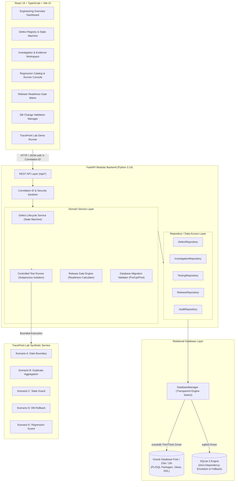
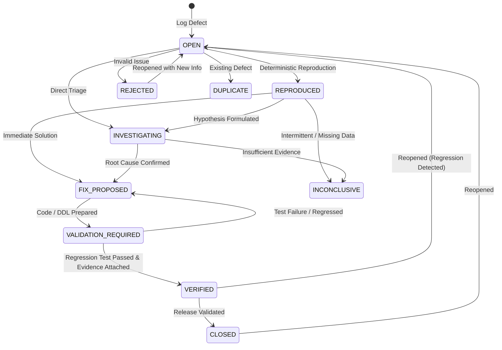

# TracePoint Architecture & Engineering Design

TracePoint is an engineering intelligence, root-cause investigation, automated testing, and release reliability platform designed to demonstrate technical competency relevant to an Oracle Application Software Engineer 1 role.

Unlike generic ticketing tools, TracePoint explicitly connects:
**Defect → Reproduction Steps → Technical Evidence → Investigation Hypotheses → Confirmed Root Cause → Code/SQL Correction → Automated Regression Test → Release Gate Validation.**

---

## 1. System Architecture

---

## 2. Defect State Machine Architecture

Transitions between defect states are strictly validated. Critical transitions (such as moving to `VERIFIED` or `CLOSED`) reject arbitrary updates unless required technical evidence and passing regression test results exist.

---

## 3. Controlled Test Runner Architecture

TracePoint avoids unsafe arbitrary shell execution.
1. **Command Allowlist**: Only bounded, known pytest suites are executable through the runner:
   - `pytest demo_lab/tests/test_scenario_a_date_boundary.py -v`
   - `pytest demo_lab/tests/test_scenario_b_duplicate_aggregation.py -v`
   - `pytest demo_lab/tests/test_scenario_c_invalid_transition.py -v`
   - `pytest demo_lab/tests/test_scenario_d_db_integrity.py -v`
   - `pytest demo_lab/tests/test_scenario_e_regression_guard.py -v`
   - `pytest tests/unit/ -v`
   - `pytest tests/api/ -v`
   - `pytest demo_lab/tests/ -v`
2. **Execution Boundary**: Runs via `subprocess.run` with a 25-second maximum timeout.
3. **Capture & Telemetry**: Captures exact exit codes, stdout, stderr, execution duration, and extracts parsed passed/failed/skipped counts.
4. **Audit Linkage**: Automatically creates a record in `TEST_RUNS` and updates `REGRESSION_TESTS.last_outcome`.

---

## 4. Objective Release Readiness Engine

A software release cannot transition to `READY_FOR_REVIEW` or `APPROVED` merely by user preference. The Release Readiness Engine computes readiness deterministically using the following formula:

$$\text{Readiness Score} = \left( \frac{\text{Passed Checks} + \text{Waived Checks}}{\text{Total Checks}} \right) \times 100$$

A release is marked `BLOCKED` if:
1. Any mandatory release check is `FAILED` or `PENDING`.
2. Any open `CRITICAL` or `HIGH` defect linked to the release remains unresolved (`status NOT IN ('VERIFIED', 'CLOSED')`).
3. Any regression test run associated with the target release has an outcome of `FAILED`.
4. Any mandatory database migration is unapplied or failed.
