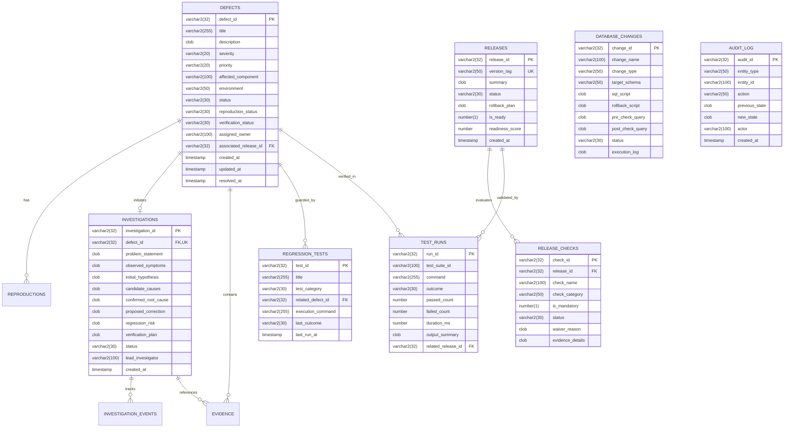

# TracePoint Oracle Database & PL/SQL Engineering Guide

This guide details the Oracle Database architecture, relational entity model, PL/SQL packages, analytical reporting views, and controlled migration validation protocols implemented in TracePoint.

---

## 1. Entity Relationship Diagram (ERD)



---

## 2. PL/SQL Packages

### `PKG_DEFECT_LIFECYCLE`
Provides transactional integrity, state-transition validation, and immutable audit logging within a single atomic database transaction.

- **`transition_defect` Procedure**:
  - Validates source to destination status transition against allowlisted rules.
  - Enforces that transitioning to `VERIFIED` requires `verification_status = 'VERIFIED'` and attached evidence.
  - Automatically records the state change in `AUDIT_LOG` with correlation tracking.
  - Rolls back atomically if any validation or constraint fails.

```sql
PROCEDURE transition_defect(
    p_defect_id     IN VARCHAR2,
    p_new_status    IN VARCHAR2,
    p_actor         IN VARCHAR2,
    p_reason        IN VARCHAR2,
    p_status_code   OUT NUMBER,
    p_message       OUT VARCHAR2
);
```

### `PKG_RELEASE_GATE`
Encapsulates database-side release readiness verification:
- Evaluates mandatory release checks (`RELEASE_CHECKS`).
- Scans for unresolved `CRITICAL` or `HIGH` severity defects associated with the release.
- Verifies that all regression test runs (`TEST_RUNS`) passed.
- Computes readiness score ($0-100\%$) and emits human-readable blocking reasons.
- Atomically updates `RELEASES.is_ready`, `RELEASES.readiness_score`, and `RELEASES.status`.

```sql
PROCEDURE evaluate_readiness(
    p_release_id    IN VARCHAR2,
    p_is_ready      OUT NUMBER,
    p_score         OUT NUMBER,
    p_blockers      OUT VARCHAR2
);
```

---

## 3. Analytical Reporting Views

1. **`V_OPEN_DEFECTS_BY_SEVERITY`**: Aggregates unresolved defects by severity, tracking reproduction and verification debt.
2. **`V_DEFECTS_AWAITING_VERIFICATION`**: Identifies defects where fixes have been proposed but awaiting test runs.
3. **`V_UNCONFIRMED_INVESTIGATIONS`**: Reports active investigations where hypotheses have not yet been supported with technical evidence.
4. **`V_FAILED_REGRESSION_TESTS`**: Correlates test suite failures with target releases and guarding defects.
5. **`V_BLOCKED_RELEASES`**: Audits releases blocked by outstanding checks.
6. **`V_DEFECT_RESOLUTION_METRICS`**: Computes historical resolution time (hours) by severity.
7. **`V_REOPENED_DEFECT_ANALYSIS`**: Tracks defect churn by counting status regressions from `CLOSED` to `OPEN`.
8. **`V_DB_CHANGE_STATUS`**: Tracks status across database migrations.

---

## 4. Controlled Database Migrations & Transactional Rollback

In Oracle Database, DDL statements (`CREATE`, `ALTER`, `DROP`) execute an implicit `COMMIT` before and after execution. Therefore, DDL cannot be rolled back with standard transaction `ROLLBACK`.

TracePoint addresses this by structuring migrations into a 4-phase protocol:
1. **Pre-check Query**: Asserts precondition (e.g. index/table does not exist).
2. **Up Migration DDL**: Executes the approved SQL script.
3. **Post-check Query**: Asserts the target database object exists and is in `VALID` status.
4. **Rollback Script**: Pre-approved explicit reverse DDL documented alongside the migration.
